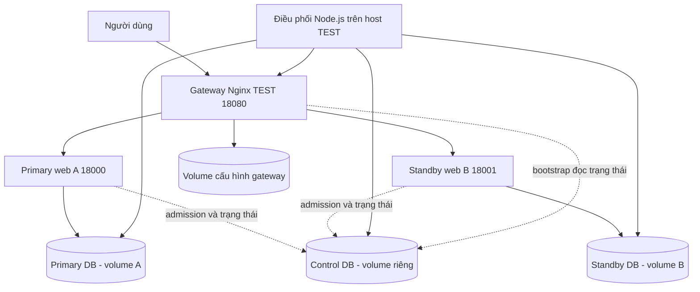
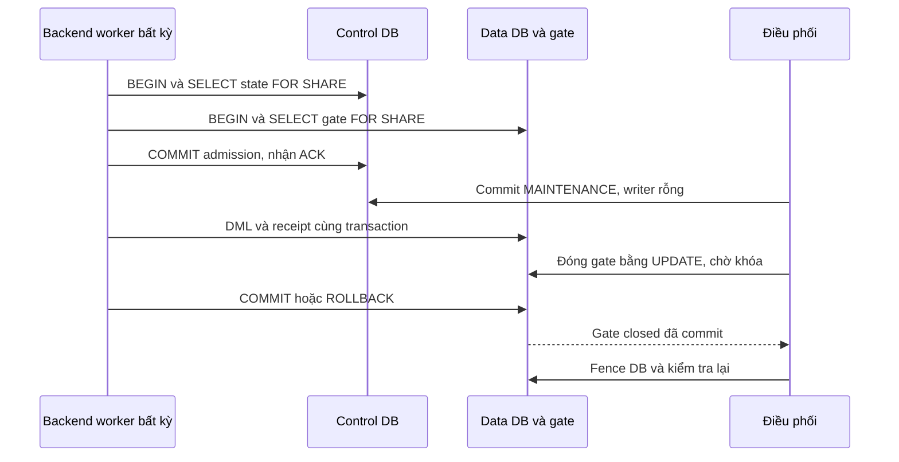
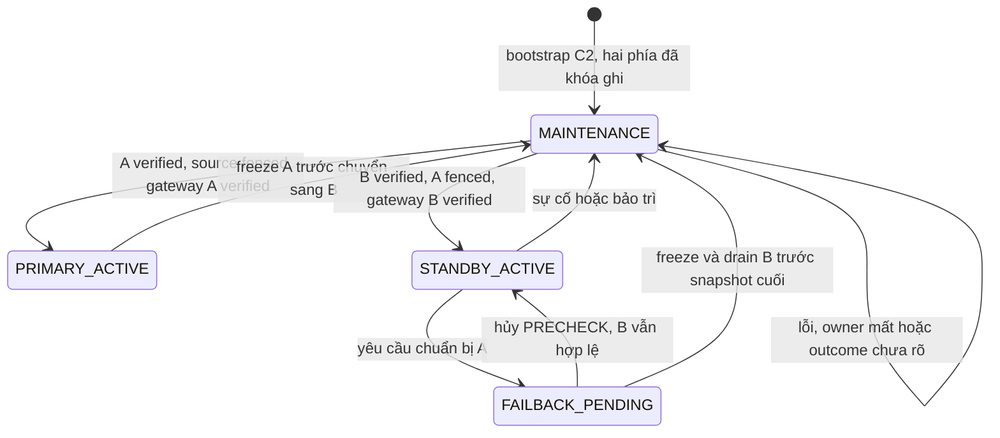
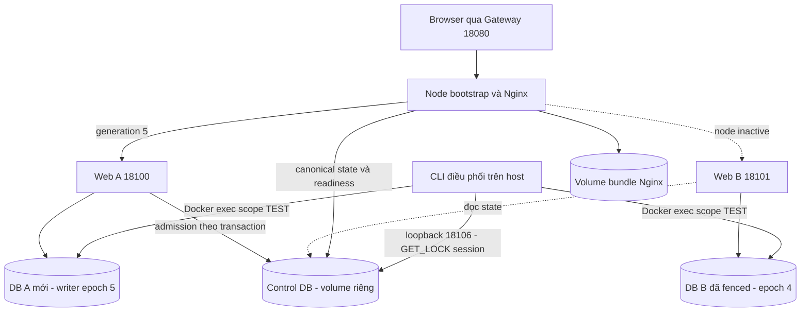

# ShopOnline — Thiết kế Primary/Standby PHA C1

Ngày 17/11/2026, múi giờ Asia/Saigon. Tài liệu thiết kế để duyệt trước PHA C2.

## 1. Baseline đã đối chiếu

| Hạng mục | Quan sát chỉ đọc trong C1 |
| --- | --- |
| Worktree / branch | `D:\BTL_platform\shoponline-integration` / `integration/shoponline-completion` |
| HEAD | `17c46552eb27a744c447bb7f323fb591e7f5058b` |
| Ba commit PHA A/B | `5ae7d1f`, `61ad4e5`, `17c4655`, đúng yêu cầu người dùng |
| Git lúc bắt đầu | Working tree sạch, diff rỗng, danh sách untracked rỗng |
| TEST project | `shoponline-test-b-20261117`, bốn service running/healthy |
| Web A / B | `127.0.0.1:18000` / `127.0.0.1:18001`, node `test-primary` / `test-standby` |
| DB thực tế | Cả hai dùng tên `shoponline_check_phase_b`, trên hai server/volume riêng |
| MySQL | `8.0.46` ở cả A/B |
| Server UUID A | `5197033f-e297-11f1-908f-321b3f12d865` |
| Server UUID B | `518cc802-e297-11f1-bd80-32ca2bca3ebd` |
| Dữ liệu A | 26 sản phẩm, 11 đơn, 12 chi tiết |
| Dữ liệu B | 22 sản phẩm, 10 đơn, 11 chi tiết |
| Cờ DB hiện tại | `read_only=0`, `super_read_only=0` trên cả hai DB |
| Schema hiện tại | `products`, `orders`, `order_items` |

Số bản ghi khớp báo cáo cuối PHA B. Các đoạn báo cáo PHA B ghi HEAD `b1aef42` thuộc thời điểm kiểm thử trước ba commit đã tạo. Commit nền C1 hiện là `17c4655` như yêu cầu mới.

`/health` hiện chạy `SELECT 1`, còn `databaseName` lấy từ môi trường. Truy vấn SELECT riêng trong C1 đã xác nhận database thực. Backend hiện có POST orders, POST/PUT/DELETE products; PATCH chưa được khai báo. Order và DELETE product có transaction, CREATE/UPDATE product còn dùng pool/autocommit. `expectedStock` bảo vệ cập nhật tồn kho trong một DB. Chưa có gateway, coordinator, write guard liên node, drain hay readiness đủ điều kiện chuyển đổi.

Hai bộ dữ liệu TEST hiện độc lập. Đề xuất lấy A làm nguồn có thẩm quyền ban đầu khi bootstrap C2, bảo quản DB hiện hữu của cả A/B để đối chiếu. Việc chọn nguồn cần người dùng duyệt vì các đơn thử trên B hiện khác A.

## 2. Quyết định kiến trúc đề xuất

Đề xuất chuyển đổi thủ công bằng một bộ điều phối có journal bền vững. URL chung là `http://127.0.0.1:18080`. Thêm `gateway` và `control-db` vào TEST bằng overlay C2, giữ tài nguyên demo ở project riêng. C2 sẽ có sáu service thường trực và bốn volume theo project.



Gateway chọn đúng một upstream business ở mỗi generation. Việc mở ghi do coordinator và DB gate quyết định. Quyền này có hiệu lực với cả request qua gateway và request trực tiếp 18000/18001.

| Phương án điều phối | Khả năng và giới hạn | Đánh giá |
| --- | --- | --- |
| Biến môi trường / RAM | Hữu ích để cấu hình kết nối và định danh; các process có vòng đời, cache và thời điểm restart khác nhau | Cấu hình đầu vào |
| File JSON chung, atomic rename và khóa host | Ít service, cần xử lý consistency của Windows/Linux mount, mất khóa, các reader và DB đang có transaction | Phương án đơn giản hơn cần thiết kế fence DB tương đương |
| Control DB InnoDB cùng DB gate và fence DB nguồn | Có cập nhật nguyên tử, row lock và journal dùng chung cho nhiều process; phát sinh thêm service và phụ thuộc coordinator | **Đề xuất duyệt** |
| Coordinator quorum, replication/HA đa host | Phù hợp khi mở rộng miền lỗi, cần quorum, fencing hạ tầng và vận hành phân tán | Phương án mở rộng sau đồ án hiện tại |

### Giới hạn miền lỗi

A/B có dữ liệu trên volume độc lập nhưng dùng chung Docker Engine, WSL/VM, ổ đĩa host và gateway. Mất host, lỗi WSL, hỏng ổ đĩa hoặc mất control-db có thể làm ngừng cả hệ thống. Control DB và Nginx cũng là điểm lỗi đơn. Thiết kế hỗ trợ chuyển dịch vụ giữa hai cặp trong lab; khả năng chịu mất một máy vật lý cần nhiều host và bản sao ngoài host. Sự cố WSL trong PHA B đã cho thấy giới hạn này.

### Biên tin cậy

Bảo đảm single-writer áp dụng cho các backend C2, credential được quản lý và các script điều phối tuân thủ giao thức. Tài khoản Docker/admin MySQL của người vận hành có thể thay cấu hình hạ tầng; việc quản lý các quyền đó thuộc biên vận hành tin cậy. Web dùng tài khoản DML tối thiểu và tài khoản SELECT coordinator. Quyền thay trạng thái, đổi gate, cấp quyền DB và đổi cấu hình gateway thuộc bộ điều phối trên host TEST.

## 3. Nguồn trạng thái, cập nhật nguyên tử và khóa

### Dữ liệu bền vững dự kiến

| Vị trí | Nội dung | Chủ thể được sửa |
| --- | --- | --- |
| `control-db.shoponline_control.cluster_state` | Namespace, revision, state, active_writer, epoch, binding DB A/B, generation gateway, transition hiện tại | Điều phối |
| `transition_journal` | Transition ID, source/target, owner session/PID, bước đã xác nhận, kết quả từng bước và lỗi | Điều phối |
| `snapshot_verifications` | Manifest/checksum, server/DB đích, schema/data digest, trạng thái xác minh và lần activation | Verifier Nam thông qua điều phối |
| DB ứng dụng C2 `runtime_write_gate` | Một row gate, node/server/DB binding, epoch, open/closed, transition ID | Điều phối; backend chỉ SELECT |
| DB ứng dụng C2 `runtime_write_receipts` | Request key, payload hash, kết quả nghiệp vụ và response đã commit cùng dữ liệu | Backend trong chính transaction nghiệp vụ |
| Volume gateway | Bundle cấu hình bất biến theo generation, hash, con trỏ đang dùng và bản trước | Helper gateway do điều phối gọi |

Hai bảng runtime được đề xuất thêm vào **DB C2 mới**. Bản dump đơn database sẽ mang theo receipt cùng dữ liệu nghiệp vụ. Gate được rebind có kiểm soát sau restore. Ba bảng nghiệp vụ và các DB PHA B hiện hữu được giữ làm bản đối chiếu khi bootstrap C2.

Mỗi lần cập nhật coordinator dùng một transaction InnoDB, khóa row trạng thái bằng `FOR UPDATE`, kiểm tra revision/transition/owner rồi tăng revision. State và bước journal tương ứng commit cùng nhau. Epoch writer và generation gateway tăng dần, kể cả khi rollback; chúng được truyền dưới dạng chuỗi số để tránh giới hạn số nguyên JavaScript. Một bộ ghi có thể trải qua nhiều revision. Revision, epoch và generation có mục đích riêng.

Control volume dùng cấu hình durability InnoDB phù hợp với commit bền vững. C2 cần kiểm tra cấu hình flush và thử restart thực tế. Backup coordinator cũ được phục hồi phải qua quy trình reconciliation với cả hai DB đã fence để ngăn lùi epoch.

### Khóa các thao tác chuyển đổi

Một process điều phối Node.js giữ kết nối chuyên dụng tới control-db và gọi `GET_LOCK('shoponline.test-b-20261117.switch', 0)`. Process thứ hai trả `TRANSITION_BUSY` trước các tác động khác. Cùng kết nối đó kiểm tra `IS_USED_LOCK`/`CONNECTION_ID`, thực hiện journal và các commit coordinator; reconnect ngầm bị vô hiệu hóa trong một transition. C2 sẽ dùng wrapper PowerShell gọi Node.js, tránh kiểu gọi MySQL một lần lấy lock rồi thoát phiên. Named lock gắn với session và có phạm vi một MySQL server. [MySQL locking functions](https://dev.mysql.com/doc/refman/8.0/en/locking-functions.html).

Advisory lock kết hợp với journal và fence tài nguyên. Khi mất kết nối lock, process dừng phát lệnh thay đổi, bỏ tự động rollback và để transition ở trạng thái cần reconciliation. Một transition còn dang dở chặn lượt switch mới ngay cả khi named lock đã được thả. Quá hạn heartbeat phục vụ cảnh báo; việc tiếp quản đòi hỏi xác minh owner cũ cùng lệnh admin con đã kết thúc và đọc lại fence thực tế. Process bị tạm dừng còn sống hoặc lệnh Docker/SQL chưa rõ kết quả là lý do giữ maintenance.

Mỗi thay đổi gate cũng kiểm tra epoch/transition dự kiến và từ chối epoch thấp hơn giá trị đã lưu. Các lệnh đổi biến global MySQL và reload Nginx có hiệu lực ngoài transaction coordinator. Vì vậy journal cùng chính sách xử lý owner/lệnh con chưa rõ là điều kiện bắt buộc trước takeover; fencing token cần được kiểm ở từng tài nguyên thay đổi.

## 4. Bất biến single-writer và đồng nhất giữa process

Các điều kiện mở ghi của một request gồm trạng thái coordinator cho phép node hiện tại, epoch/binding khớp, admission đã xác nhận, gate DB ứng dụng đang mở cùng epoch, credential hợp lệ và DB runtime cho phép ghi. Mọi request mới đọc coordinator trực tiếp. Cache positive permission và biến môi trường chỉ đóng vai trò quan sát/cấu hình, quyền ghi được xác nhận lại theo giao thức dưới đây.

### Giao thức admission cho mọi transaction ghi

1. Guard toàn cục nhận diện mọi HTTP method có thể thay đổi dữ liệu. Các route hiện có và future POST/PUT/PATCH/DELETE đều đi qua guard. GET/HEAD có hợp đồng chỉ đọc; endpoint mới có side effect phải dùng wrapper ghi.
2. Mở transaction ngắn trên control-db, đọc singleton state bằng `FOR SHARE`. Kiểm tra namespace TEST, node, epoch, binding và trạng thái cho phép ghi.
3. Trong lúc giữ shared lock coordinator, lấy data connection, bắt đầu transaction nghiệp vụ và giữ `runtime_write_gate` bằng `FOR SHARE`. Đọc `DATABASE()` và server UUID trên chính connection này, kiểm tra gate/node/DB/epoch.
4. Commit transaction admission trên control-db và xác nhận kết quả. Nếu admission lỗi hoặc chưa rõ kết quả, rollback data transaction trước DML.
5. Thực hiện toàn bộ thay đổi nghiệp vụ và receipt trên **cùng data connection/transaction**, giữ shared lock gate tới commit/rollback. Response thành công chỉ phát sau commit đã xác nhận.
6. Luôn giải phóng connection theo kết quả SQL thực tế, kể cả khi HTTP client ngắt kết nối. Mỗi bước chờ admission/connection có deadline hữu hạn; connection đến muộn phải được thu hồi và rollback.



Shared lock gate giữ tới cuối transaction làm cho thao tác đóng gate phải chờ các transaction đã admission. Việc cập nhật MAINTENANCE được tuần tự hóa với các admission ngắn. Request admission trước ranh giới đó được drain; request đến sau bị từ chối. Các process dùng cùng row gate nên số lượng worker và vòng đời process không làm mất barrier. Đây là phương án suy luận từ cơ chế locking read InnoDB, cần các ca cạnh tranh C2 xác nhận. [MySQL locking reads](https://dev.mysql.com/doc/refman/8.0/en/innodb-locking-reads.html).

C2 cần đưa CREATE/UPDATE product và transaction order/DELETE vào wrapper chung, tái sử dụng validation, SQL khóa sản phẩm và shape response của PHA B. Middleware chỉ kiểm tra state rồi gọi các truy vấn autocommit hiện tại sẽ thiếu barrier này. PATCH hiện chưa có handler; khi node active vẫn có thể trả 404 cho route chưa hỗ trợ, còn guard chặn mutation trên node inactive trước khi route mới được bổ sung.

### Fence nhiều lớp tại DB nguồn

Trước khi node mới được mở ghi, điều phối phải có bằng chứng nguồn gồm gate closed đã commit, kết thúc các session writer cũ, credential cũ bị khóa/thu hồi quyền ghi, cùng `read_only=ON` và `super_read_only=ON` được đọc lại. Kiểm tra transaction/lock trên server bổ sung cho barrier gate. Lệnh setter bị timeout hoặc session chưa kết thúc khiến bằng chứng chưa đầy đủ.

`super_read_only` bổ sung rào cản cho các client có quyền cao hơn; tài khoản web cần DML tối thiểu và quyền SELECT gate, loại các quyền quản trị thay biến server. Việc bật read-only có thể phải đợi statement/transaction/metadata lock, nên kết quả cần đọc lại sau khi lệnh hoàn tất. [MySQL server system variables](https://dev.mysql.com/doc/refman/8.0/en/server-system-variables.html#sysvar_read_only).

C2 đề xuất lưu mặc định `read_only=ON`, `super_read_only=ON` cho lần khởi động DB tiếp theo. Activation chỉ đổi runtime sau khi có fence proof và coordinator phù hợp. Bootstrap/restore chạy trong cửa sổ admin có kiểm soát sau khi credential web cũ đã bị vô hiệu hóa; sau đó seal DB. Cách này tránh áp đặt read-only vào bước MySQL entrypoint đang tạo schema/seed lần đầu. C2 phải thử persistent variables, `persisted_globals_load` và restart với MySQL 8.0.46 thực tế. [MySQL SET and persisted settings](https://dev.mysql.com/doc/refman/8.0/en/set-variable.html).

### Process cũ, mất kết nối và restart

- Web A cũ khởi động lại sau khi B active đọc state B, dùng epoch/credential cũ và bị từ chối. Truy cập trực tiếp A cũng bị chặn bằng cùng guard/gate/credential.
- Mất control-db làm request admission mới trả 503. Request đã giữ data gate được hoàn tất hoặc rollback; barrier trên data DB vẫn tồn tại nếu kết nối coordinator mất.
- DB restart trở về read-only. Backend active chỉ trở lại write-ready sau khi điều phối reconcile đúng node, data binding, epoch và quyền runtime. Việc rearm dùng epoch mới.
- Epoch/binding được kiểm tra trên connection thực. Pool cũ trỏ DB cũ sẽ không vượt qua admission. Recreate target web loại các pool cũ trước promotion.
- Web PHA B cũ và credential `shoponline_test` được fence khi bootstrap C2 trước activation đầu tiên. Gate chống process tuân thủ protocol; khóa credential và DB read-only bảo vệ thêm trước process legacy.

## 5. State machine và chính sách phục vụ

`active_writer` mô tả quyền admission mới. Trong MAINTENANCE, các transaction nguồn đã admission được drain trước khi fence hoàn tất. Node đích chỉ được mở ghi sau ranh giới đó.

| State | Gateway business traffic | Quyền ghi mới | Node còn lại / DB | Chuyển tiếp, lỗi và restart |
| --- | --- | --- | --- | --- |
| `PRIMARY_ACTIVE` | A, generation đã xác nhận | A trên binding/epoch hiện tại | B chặn business API, DB sealed hoặc DB ứng viên ngoại tuyến | Chuyển qua MAINTENANCE. Restart đọc state bền vững; health/readiness quyết định phục vụ |
| `MAINTENANCE` | Gateway có thể đang giữ source hoặc đã trỏ candidate; business API trả 503 | Rỗng; source in-flight kết thúc qua drain | Sau barrier, source sealed và target được chuẩn bị ở DB mới | Hoàn tất thành state active phù hợp; lỗi giữ maintenance/journal. Restart tiếp tục reconciliation từ bước đã xác nhận |
| `STANDBY_ACTIVE` | B, generation đã xác nhận | B | A sealed, credential cũ bị khóa | Sang FAILBACK_PENDING để chuẩn bị A hoặc MAINTENANCE cho sự cố; startup A giữ inactive |
| `FAILBACK_PENDING` | B | B trong giai đoạn PRECHECK có binding/epoch hiện tại | A chặn business API, chỉ probe và kiểm tra chuẩn bị | Sang MAINTENANCE trước khi freeze B/backup cuối. Có thể hủy kế hoạch về STANDBY_ACTIVE sau kiểm tra B; restart giữ source B |

Trong FAILBACK_PENDING, các bước chuẩn bị chỉ kiểm tra hạ tầng/cấu hình A. Snapshot dùng cho chuyển về được lấy **sau** bước MAINTENANCE và drain B. Mọi pha có quyền ghi rỗng trả 503 cho business API; liveness, health và diagnostic readiness tiếp tục cho phép kiểm tra chỉ đọc.

Mỗi state tham chiếu tên DB trong binding `nodes.A.database` và `nodes.B.database`, cùng server UUID và epoch tương ứng. Tên DB mới được cập nhật trong journal/binding trước khi process đích được tạo lại và kiểm readiness.



Các mũi tên từ MAINTENANCE luôn cần source/target/epoch trong journal. Sau khi writer mới đã publish, quay về node trước là một transition dữ liệu mới với source có thẩm quyền hiện tại.

## 6. Maintenance, drain và commit chưa rõ

### Quy trình một lần chuyển

| Bước | Tác động dự kiến trong C2 | Bằng chứng phải có trước bước sau |
| --- | --- | --- |
| S0 PRECHECK | Lấy lock, xác nhận project, source/state/revision và source có thẩm quyền | Namespace/labels/DB UUID đúng, owner hợp lệ |
| S1 FREEZE | Commit MAINTENANCE, writer rỗng, reserve epoch mới và journal | ACK từ coordinator, các admission mới nhận 503 |
| S2 DRAIN | Đóng source gate bằng UPDATE có kiểm tra epoch; đợi in-flight | UPDATE gate commit, session/transaction cũ đã kết thúc, outcome được đối chiếu |
| S3 FENCE | Vô hiệu hóa credential cũ, read-only nguồn, seal và lưu proof | Đọc lại gate, cờ DB, sessions, binding và durable boot policy |
| S4 DATA | Chọn/tạo backup, restore DB đích mới và đối chiếu | Manifest, checksums, schema/data/receipt digest, target sealed |
| S5 BIND | Sinh config DB/user/epoch, recreate target web | Candidate readiness đúng pool, node, DB UUID/name và manifest |
| S6 ROUTE | Stage/test/reload Nginx, đợi worker cũ, probe generation | Gateway chọn target, candidate qua gateway đúng, writer vẫn rỗng |
| S7 ARM | Chuẩn bị quyền runtime và mở target gate cho epoch dự kiến | Source fence còn hợp lệ, target ready-for-promotion, coordinator vẫn MAINTENANCE |
| S8 PUBLISH | Commit state active/active_writer mới và gateway generation đã xác nhận | Commit xác nhận là ranh giới activation |
| S9 VERIFY | Kiểm tra read/active readiness và smoke có ghi chỉ trên TEST | Ghi journal kết quả. Lỗi sau S8 xử lý theo source mới |

Giá trị đề xuất cho lab là admission tối đa 5 giây, drain 30 giây, đợi worker Nginx cũ 15 giây. Đây là cấu hình cần duyệt và đo lại ở C2. Timeout tạo trạng thái cần xử lý; bằng chứng DB quyết định khi nào đủ điều kiện tiếp tục.

### Request dài, ngắt kết nối và dừng process

Counter HTTP theo process giúp quan sát và phải bao gồm công việc SQL đang chạy sau khi client disconnect. `res.finish`, socket close hoặc timer hết hạn chưa xác nhận transaction đã dừng. Khi quá drain deadline, điều phối giữ maintenance, thu thập session/transaction ID thuộc writer TEST và chờ/kết thúc session theo chính sách được duyệt. Sau khi session bị kết thúc, phải chờ rollback/khóa thực sự được giải phóng rồi lấy barrier lại.

Nếu data connection mất trong COMMIT, trạng thái request là UNKNOWN cho đến khi đối chiếu bằng request key. `runtime_write_receipts` được insert cùng transaction trước DML và lưu kết quả cùng commit. Receipt tồn tại xác nhận dữ liệu đã commit. Receipt vắng chỉ kết luận rollback sau khi nguồn đã fence, các transaction đã kết thúc và truy vấn mới đã xác nhận.

Đề xuất client tạo `Idempotency-Key` cho thao tác ghi và giữ key/body khi đang chờ kết quả. Key trùng cùng payload trả kết quả đã commit; key trùng khác payload trả 409. Request key có unique constraint trong DB, C2 cần kiểm tra cạnh tranh key trùng. Frontend giữ trạng thái pending khi nhận `COMMIT_OUTCOME_UNKNOWN` để tra cứu trước khi gửi lại. Receipt theo cùng snapshot khi chuyển DB; với sự cố làm mất phần dữ liệu sau snapshot, key vắng ở bản sao vẫn có thể là outcome chưa rõ.

Receipt được tra/reserve theo unique key trước logic nghiệp vụ, để retry của một mutation đã commit có thể trả kết quả cũ trước khi kiểm tra điều kiện dữ liệu hiện tại. Hash xác định từ method/path/body và chủ thể request khi có auth; node/DB/epoch thuộc metadata nguồn. C2 cần xử lý duplicate key bằng rollback và đọc lại receipt đã commit, đồng thời giữ binding/namespace khi copy snapshot.

## 7. Liveness, health, readiness và status

| Endpoint đề xuất | Kiểm tra | HTTP |
| --- | --- | --- |
| `GET /live` | Process/event loop đang phục vụ, trạng thái shutdown | 200 hoặc 503 |
| `GET /health` | DB connection hoạt động, thêm database thực/server UUID và định danh node | 200 khi kết nối được, 503 khi lỗi kết nối |
| `GET /ready` | Toàn bộ điều kiện active gồm coordinator, binding, schema, gate, quyền writer, gateway generation | 200 khi active-ready, còn lại 503 |
| `GET /ready?intent=candidate&transition_id=...` | Target đã verify, sealed, đúng transition; chuẩn bị nhận traffic, chưa cấp quyền business write | 200 khi candidate hợp lệ, còn lại 503 |
| `GET /cluster/status` | Bản chiếu canonical state/revision, node active và transition, chỉ đọc | 200 hoặc 503 nếu coordinator lỗi |
| `GET /api/write-status/:requestId` | Tra cứu outcome đã biết trên nguồn canonical | 200 với COMMITTED/known outcome, UNKNOWN được biểu diễn rõ |

Readiness truy vấn `DATABASE()`, server UUID, gate và schema qua đúng pool/connection mà handler sẽ dùng. Các bảng bắt buộc ở C2 là ba bảng nghiệp vụ cùng hai bảng runtime. Cần so fingerprint kiểu cột, PK/FK, schema version; kết nối thành công tới một DB rỗng hoặc sai server cùng tên phải bị từ chối.

Ví dụ response candidate là dữ liệu hợp đồng dự kiến.

```json
{
  "status": "candidate_ready",
  "environment": "test",
  "nodeId": "test-standby",
  "state": "MAINTENANCE",
  "revision": "18",
  "epoch": "42",
  "transitionId": "T-example",
  "database": {
    "configuredName": "shoponline_check_b_r_20261117_t0042",
    "actualName": "shoponline_check_b_r_20261117_t0042",
    "serverUuid": "518cc802-e297-11f1-bd80-32ca2bca3ebd",
    "schemaVersion": "2",
    "readOnly": true,
    "superReadOnly": true
  },
  "writer": {"enabled": false, "gate": "closed", "gateEpoch": "42"},
  "verification": {"manifestId": "snapshot-example", "state": "verified", "sealed": true},
  "checks": {"node": true, "binding": true, "schema": true, "coordinator": true, "data": true}
}
```

Active-ready dùng `status=ready`, writer enabled và state active đúng node. Candidate-ready dùng bộ kiểm tra đối xứng cho DB sealed. Giai đoạn ARM có kiểm tra promotion riêng trong điều phối, gồm quyền runtime đã chuẩn bị trong lúc coordinator vẫn chặn ghi.

Commit S8 đồng thời đánh dấu các bước an toàn đã hoàn tất và activation đã publish trong journal. Post-check S9 là kiểm tra sau activation; active readiness không chờ S9 mới cho phép probe. Một journal còn thiếu fence, binding hoặc route proof vẫn là transition chưa hoàn tất và chặn promotion.

Lỗi readiness trả 503 cùng `reasons`, chẳng hạn `NODE_MISMATCH`, `DATABASE_MISMATCH`, `SCHEMA_MISMATCH`, `SNAPSHOT_UNVERIFIED`, `COORDINATOR_UNAVAILABLE`, `STALE_EPOCH`, `TRANSITION_INCOMPLETE`. Lỗi ghi mới dùng JSON 503 với code inactive/maintenance/unavailable. Kết quả commit UNKNOWN có request ID và thông báo tra cứu, hướng retry phân biệt với request đã bị từ chối trước admission. HTTP 409 của expectedStock tiếp tục theo hợp đồng PHA B.

Script điều phối gọi direct candidate readiness và đối chiếu toàn bộ identity/epoch/manifest với kế hoạch của nó, sau đó probe lại qua gateway. HTTP 200 cùng identity sai vẫn là FAIL. Nginx OSS định tuyến theo cấu hình đã được script xác minh; health đơn lẻ của Nginx không quyết định promotion.

## 8. Chuyển DB sau restore — Nam chủ trì

### Manifest và snapshot hợp lệ

Mỗi bản backup có ID, namespace TEST, source node/server UUID/database, source epoch, trạng thái frozen/online, thời gian bắt đầu/kết thúc UTC, mã thoát, số byte, encoding, SHA-256 SQL, schema fingerprint, counts và data digests. Khi nguồn đã freeze, ghi thêm fence proof và receipt cuối đã biết. Dump thành công được công bố qua manifest hoàn tất sau khi file đã ghi đủ; file dang dở có trạng thái failed/quarantined.

Helper ưu tiên raw bytes qua `mysqldump`/`docker cp`, với `--single-transaction`, `--quick`, `--no-tablespaces`, `--set-gtid-purged=OFF` và dump một logical DB. Tất cả bảng được đối chiếu phải InnoDB. Snapshot transactional vẫn cần loại trừ DDL đồng thời; thông tin thời điểm kết thúc dump chưa xác định thời điểm snapshot chính xác. [MySQL mysqldump](https://dev.mysql.com/doc/refman/8.0/en/mysqldump.html).

File rỗng, native exit code khác 0, checksum sai, UTF-16LE/UTF-16BE hoặc encoding chưa được xác minh bị loại trước import. C2 ưu tiên từ chối dump legacy rồi tạo bản mới từ nguồn hợp lệ. Nếu cần chuyển encoding, tạo artifact mới có kiểm tra tiếng Việt và hash riêng để review. SQL nhập thuộc helper/manifest tin cậy, có kiểm tra phạm vi một DB, inventory routine/trigger/event và quyền tối thiểu của tài khoản import. Hash cần đi cùng nguồn manifest tin cậy.

### Chuỗi thao tác target

1. Resolve source/target bằng project/service và kiểm tra Docker labels, image/protocol, server UUID. Truyền container ID và DB name rõ ràng vào helper, loại phụ thuộc mặc định `primary-db/shoponline` của script cũ.
2. Tạo tên DB mới theo prefix `shoponline_check_`, timestamp/transition và độ dài identifier hợp lệ. Đụng tên DB đã tồn tại là lỗi, retry dùng DB mới hoặc đối chiếu journal.
3. Tạo DB qua tài khoản điều phối, import bằng tài khoản giới hạn vào DB mới trong cửa sổ admin maintenance. Các API writer đang bị chặn. DB cũ cùng volume được bảo quản.
4. Đối chiếu schema, engine, charset/collation, columns/types/defaults, PK/FK/delete rules, indexes, CHECK và orphan rows.
5. So **từng row** của products, orders, order_items và receipts bằng serialization ổn định theo PK, giữ DECIMAL chính xác, NULL, Unicode và timestamp UTC. Hash theo bảng/chunk hỗ trợ phát hiện khác biệt và báo row lệch. So totals, tên/giá snapshot, quantity, stock và AUTO_INCREMENT cần thiết.
6. Rebind row gate từ source sang target node/server/DB/epoch ở trạng thái closed. Sai khác có chủ đích của gate được ghi trong manifest; dữ liệu nghiệp vụ và receipt phải khớp snapshot.
7. Seal target, đăng ký verification certificate gắn manifest/server UUID/DB/schema/data digest và transition. Candidate có thay đổi dữ liệu trước promotion phải verify lại.
8. Cấp credential theo node/epoch, quyền đúng DB mới; sinh override cấu hình TEST có generation/hash và đường dẫn secret riêng. Các credential cũ bị khóa/thu hồi và session cũ được kết thúc.
9. Recreate **target web TEST**, xác nhận mọi process/pool dùng binding mới bằng readiness. Env/config trên đĩa chỉ có hiệu lực sau khi process/pool tương ứng được thay thế.
10. Chuyển gateway và ARM/PUBLISH theo mục 6. Bảo quản DB/config/manifest cũ để rollback khi còn hợp lệ và để đối chiếu sau activation.

### Bootstrap C2 từ kết quả PHA B

Đề xuất dùng overlay `compose.c2.test.yml` trên project TEST hiện tại để tiếp tục dùng 18000/18001, thêm gateway 18080. Bootstrap bắt đầu ở MAINTENANCE, khóa các credential/process TEST legacy và xác nhận hết transaction. Sao lưu cả hai DB PHA B; nguồn A được clone vào một DB C2 mới rồi thêm bảng runtime. B giữ inactive cho tới khi được chuẩn bị bằng snapshot hợp lệ của A. Việc này cần duyệt nguồn A ban đầu và bảo quản dữ liệu B cũ. Các cổng demo 8000/8001 và DB demo thuộc project riêng.

### Phân biệt các hoạt động và RPO

| Hoạt động | Ý nghĩa trong phương án |
| --- | --- |
| Backup/restore | Tạo artifact kiểm tra được và nạp vào DB mới |
| Sao chép snapshot | Đưa một điểm dữ liệu đã biết từ A sang B hoặc ngược lại |
| Failover dịch vụ | Đổi writer/traffic sau fence và xác minh dữ liệu |
| Failback | Freeze B, mang dữ liệu có thẩm quyền về DB mới ở A rồi đổi traffic/writer |
| Replication liên tục | Áp dụng thay đổi nối tiếp bằng cơ chế như binlog; cần một thiết kế vận hành riêng |

Backup theo lịch tạo khoảng dữ liệu có nguy cơ mất. Với backup online, thời điểm snapshot nằm trong khoảng bắt đầu/kết thúc dump. Nếu lỗi được phát hiện tại `t_detect`, cửa sổ rủi ro bảo thủ bắt đầu từ `t_dump_start` tới `t_detect`. Khi thời điểm snapshot xác định được từ cơ chế được kiểm chứng, mới thu hẹp khoảng này. `created_at`, thời gian hoàn tất dump và thứ tự UUID đều thiếu thông tin commit chính xác để kết luận tập dữ liệu mất.

Khi A còn đọc được sau sự cố, fence trước rồi so tập ID đơn, items, receipt, giá/tồn kho với manifest; đưa ra danh sách thay đổi sau snapshot cần xử lý. Khi A mất truy cập, chỉ có thể ghi nhận khoảng rủi ro và các ACK/log độc lập còn giữ. Bắt đầu có đơn mới ở B làm B trở thành nguồn canonical; việc xử lý dữ liệu A quay lại cần đối chiếu riêng. Thiết kế snapshot bất đồng bộ có RPO phụ thuộc độ cũ backup. Chuyển có kế hoạch sau drain có thể kiểm chứng bảo toàn toàn bộ commit trước barrier bằng đối chiếu dữ liệu.

## 9. Gateway Nginx và đồng bộ generation

### Cấu trúc dự kiến ở C2

```text
gateway/
  Dockerfile
  nginx.conf.template
  upstreams/
    primary.conf.template
    standby.conf.template
    maintenance.conf.template
  bootstrap.cjs
  render-config.cjs
```

Các template đóng gói cùng image. Bundle đã render nằm trong named volume TEST, có generation, transition ID và hash. Việc publish file/con trỏ dùng thao tác nguyên tử trong cùng filesystem Linux của volume, với toàn bộ directory được nhìn thấy bởi Nginx. Kế hoạch thử restart phải xác minh bundle đã được lưu bền vững.

### Switch và reload

1. Kiểm tra candidate readiness và source fence, coordinator ở MAINTENANCE.
2. Render bundle mới với **một** upstream được chọn, cấu hình header generation và các endpoint probe. Lưu bundle trước đó cùng hash để làm nguyên liệu rollback.
3. Chạy `nginx -t` trên đúng bundle dự kiến. Lỗi giữ route cũ và writer rỗng.
4. Publish bundle, gửi reload rồi theo dõi log/process. Nginx kiểm tra cấu hình khi reload và có thể tiếp tục cấu hình cũ nếu apply lỗi; worker cũ còn phục vụ các connection đã có. Vì vậy cần kiểm chứng generation và quá trình drain worker sau lệnh reload. [Nginx control](https://nginx.org/en/docs/control.html).
5. Probe direct/gateway readiness, kiểm tra node, DB binding, transition/generation và hash. Đợi các worker generation trước kết thúc trong giới hạn đã chọn.
6. Ghi `gateway_applied_generation` vào coordinator khi probe đạt. ARM/PUBLISH writer là các bước sau đó.

Đề xuất `proxy_next_upstream off` cho business API, một upstream mỗi generation và timeout hữu hạn. Request ghi có commit chưa rõ được đối chiếu bằng receipt; script chịu trách nhiệm chọn node. [Nginx proxy next upstream](https://nginx.org/en/docs/http/ngx_http_proxy_module.html#proxy_next_upstream).

Gateway ghi đè header generation từ client. Backend đối chiếu header này với canonical route/generation cho request qua gateway; direct port vẫn kiểm tra writer/binding độc lập. Worker gateway cũ hoặc config rollback nhầm generation nhận 503 từ backend, kể cả với business read, để tránh trả dữ liệu từ node cũ.

### Restart và mâu thuẫn trạng thái

Bootstrap gateway đọc coordinator bằng quyền SELECT và xác nhận active readiness trước khi tạo config phục vụ. State không xác định hoặc transition chưa hoàn tất tạo maintenance config. Bản `last-good` trên volume là artifact để đối chiếu; coordinator quyết định node/generation sau restart. Nếu B đang active, gateway tái dựng B hoặc phục vụ maintenance trong lúc B chưa ready.

Nếu gateway đã trỏ B nhưng coordinator còn MAINTENANCE, backend từ chối business API. Nếu canonical là B nhưng gateway vẫn gửi A, guard/epoch/DB fence ngăn ghi tại A và generation check ngăn business read sai nguồn. Reconciler đưa routing về trạng thái canonical đã xác nhận. Hai tài nguyên SQL và Nginx thiếu một transaction chung, nên chuỗi MAINTENANCE → route verified → publish writer là cách làm trạng thái trung gian an toàn.

## 10. Kịch bản A → B

### Chuyển có kế hoạch

1. Phát hiện nhu cầu chuyển; lấy lock và journal, xác nhận A là nguồn canonical.
2. Commit MAINTENANCE, chặn admission mới, drain A và fence DB A theo S1–S3.
3. Lấy snapshot nhất quán của A sau fence, kiểm tra artifact và restore vào DB **mới** tại B.
4. So toàn bộ dữ liệu và receipt, rebind gate B closed, seal và cấp certificate.
5. Cấu hình/recreate B đúng DB/epoch/user, candidate readiness đạt.
6. Switch/test/reload gateway sang B, đợi generation cũ, xác nhận route thực.
7. ARM B trong khi canonical writer rỗng, đọc lại source fence.
8. Publish STANDBY_ACTIVE với writer B/epoch mới, kiểm tra active readiness và ghi thử có định danh trên TEST khi được triển khai.

### Sự cố đột ngột

Phát hiện qua lỗi HTTP/health/readiness; người vận hành chạy quy trình chuyển. Nếu primary-web hỏng nhưng DB A còn quản trị được, điều phối fence qua DB, kết thúc session cũ và đối chiếu commit trước khi chọn snapshot. Tín hiệu web mất kết nối chỉ là phát hiện sự cố, khả năng ghi của A cần bằng chứng riêng.

**Phương án C2 đề xuất yêu cầu fence SQL xác minh được trên nguồn.** Khi DB A cũng mất truy cập, Docker Engine/host mất hoặc bằng chứng fence thiếu, giữ MAINTENANCE và writer rỗng. Snapshot có sẵn ở B giúp chuẩn bị dữ liệu nhưng quyền mở ghi còn chờ fence nguồn. Hỗ trợ promotion khi toàn bộ nguồn mất truy cập cần thiết kế fencing hạ tầng ngoài miền lỗi, được duyệt riêng. C2 có thể kiểm chứng lỗi primary-web với DB A còn sống; giới hạn này ảnh hưởng RTO của sự cố DB/host.

## 11. Chuẩn bị B → A cho PHA F

1. Trong STANDBY_ACTIVE, B là nguồn có thẩm quyền, kể cả khi A đã healthy trở lại.
2. Chuyển FAILBACK_PENDING để kiểm tra A, giữ B phục vụ và ghi theo binding hiện tại.
3. Khi bắt đầu cutover, MAINTENANCE chặn ghi mới, drain/fence B và đối chiếu receipt UNKNOWN.
4. Backup B sau barrier, restore vào DB mới tại A, giữ DB A cũ để đối chiếu.
5. So mọi row/PK/FK/receipt, đặc biệt các ID đơn được tạo khi B active, tên/giá/quantity/total và stock. Rebind gate A closed, verify và seal.
6. Recreate A với DB mới, candidate readiness rồi gateway A generation mới.
7. ARM A và publish PRIMARY_ACTIVE sau khi fence B còn đúng, xác nhận đơn B qua URL chung và MySQL A.

Các lỗi trước publish giữ B làm nguồn có thẩm quyền và xử lý rollback có kiểm chứng. Sau publish A, source canonical là A. C1 chỉ thiết kế luồng này; bài thực hành đầy đủ giữ đơn B sau failback thuộc PHA F.

## 12. Rollback theo ranh giới activation

Trước S8, source cũ vẫn là nguồn có thẩm quyền sau freeze và target chưa nhận admission. Có thể bỏ candidate, giữ DB đích lỗi để điều tra, render route nguồn với generation mới, xác minh source và mở lại bằng **epoch/credential mới**. Mỗi lần rollback cần fence target và proof target chưa được publish writer.

Từ S8 trở đi, target mới có thể đã commit dù HTTP chưa trả thành công. Lỗi post-check, reload hay mất kết nối ở giai đoạn này được xử lý bằng giữ nguồn mới hoặc maintenance. Quay về source cũ cần freeze nguồn mới và chuyển toàn bộ dữ liệu hiện tại vào DB mới ở node trước. Receipt giúp xác định outcome, còn việc đếm tạm thời chưa thấy đơn mới chưa chứng minh an toàn để quay về snapshot cũ.

| Lỗi | Phát hiện | Hành động an toàn / rollback | Thao tác bị cấm | Kết quả mong đợi |
| --- | --- | --- | --- | --- |
| Docker Engine không hoạt động | CLI lỗi/timeout, inventory thiếu | Đánh dấu transition chưa rõ, đợi Engine phục hồi rồi reconcile; source đang active chỉ tiếp tục theo các gate còn hợp lệ | Coi container mất truy cập là đã fence | Writer mới chưa được publish |
| Control DB mất | Admission/control transaction lỗi | Request mới 503; giữ journal và kiểm tra lại sau phục hồi | Dùng cache quyền ghi dương hoặc tự đổi nguồn | Zero admission mới khi thiếu authority |
| Nginx config sai | `nginx -t` khác 0 | Giữ source route và maintenance; sửa bundle/rollback trước publish | Reload bỏ qua kiểm tra | Candidate chưa nhận quyền ghi |
| Reload không áp dụng / timeout | Log, worker, route-generation probe sai | Writer rỗng, reconcile config; rollback route trước S8 theo generation mới | Lấy exit 0 làm đủ chứng cứ | Route/writer khớp trước publish |
| Target không healthy | Health/readiness 503 | Giữ source canonical; rollback trước S8 nếu source còn đủ điều kiện | Mở writer theo một probe cũ | Giữ maintenance hoặc phục hồi source an toàn |
| Sai node/DB/server UUID | So JSON readiness với plan và actual SQL | Quarantine candidate, sửa binding và recreate đúng target | Chấp nhận HTTP 200 sai identity | Cấu hình sai bị phát hiện |
| Restore thiếu / dữ liệu lệch | Schema/row/receipt digest và totals lệch | Giữ target closed, bảo quản artifact/DB lỗi, retry DB mới | Dùng COUNT hoặc seed cố định làm đủ proof | Chỉ bản sao đã verify được xem xét |
| Dump rỗng/encoding/hash sai | Exit code, byte count, UTF validation, SHA-256 | Từ chối trước import, chọn artifact được xác minh | Công bố dump failed thành latest, import file sai | Artifact lỗi không tới serving DB |
| Hai switch đồng thời | Named lock + owner/revision | Một owner, lượt còn lại BUSY; pending journal chặn takeover | Hai owner đổi SQL/gateway độc lập | Một chuỗi side effect có thứ tự |
| Container restart giữa switch | Boot/StartedAt, gate, journal | Read-only default và guard giữ closed; tiếp tục bước đã đọc lại | Chọn A mặc định hoặc bật quyền theo env cũ | State bền vững, restart có kiểm soát |
| Writer state UNKNOWN | Authority/binding/gate mất hoặc không khớp | 503 và reconciliation | Fail-open, xóa state để bootstrap lại | Admission mới bị từ chối |
| Node cũ quay lại | Epoch/credential/state khác | Readiness active 503, gate/DB/account cũ vẫn fence | Auto-failback hoặc reuse credential cũ | Node cũ chưa lấy lại quyền |
| Không chứng minh được A fenced | SQL unreachable, setter/transaction outcome thiếu | MAINTENANCE, giữ B closed; yêu cầu phục hồi nguồn hoặc thiết kế hard-fence được duyệt | Mở B vì A ping không được | Ưu tiên bảo toàn dữ liệu |
| A/B khác ngoài manifest | Digest/receipt/order ID/stock lệch | Dừng transition và xác định nguồn canonical | Merge hai snapshot hoặc overwrite DB đang phục vụ | Có báo cáo lệch để người dùng quyết định |
| Commit nghiệp vụ UNKNOWN | Mất ACK, receipt/chưa kết thúc session | Giữ key, chờ fence/drain và tra receipt; rollback routing tùy ranh giới S8 | Tự retry key mới hoặc kết luận abort từ HTTP timeout | Một outcome được xác minh |
| Owner chết/mất named lock | Session/PID/journal không khớp | Dừng mutation, chứng minh owner/lệnh con đã kết thúc trước resume | Tiếp quản chỉ theo thời gian lease | Pending transition được xử lý có bằng chứng |

## 13. Phân công và file dự kiến ở C2

Các file dưới đây là kế hoạch triển khai cần duyệt. C1 chỉ tạo/cập nhật ba tài liệu được yêu cầu.

| File dự kiến | Nội dung | Chủ trì / phối hợp |
| --- | --- | --- |
| `compose.c2.test.yml` mới | Overlay TEST thêm gateway/control-db/volume, binding và cấu hình role | Toàn / Nam, Ly |
| `.gitignore`, `.dockerignore` | Loại secret/config sinh/log/manifest runtime khỏi Git/build context | Toàn / Nam |
| `gateway/Dockerfile` mới | Image Nginx cùng helper bootstrap đọc control, pin phiên bản lúc C2 | Toàn / Ly |
| `gateway/nginx.conf.template` mới | Proxy, headers generation, probe, timeout | Toàn / Ly |
| `gateway/upstreams/primary.conf.template` mới | Route A theo generation | Toàn |
| `gateway/upstreams/standby.conf.template` mới | Route B theo generation | Toàn |
| `gateway/upstreams/maintenance.conf.template` mới | Maintenance khi authority/target chưa hợp lệ | Toàn / Ly |
| `gateway/bootstrap.cjs`, `gateway/render-config.cjs` mới | Đọc canonical state, render/test/reload và reconcile trên volume | Toàn / Ly |
| `database/control-schema.sql` mới | State, journal, snapshot verification và revision/epoch | Nam / Ly, Toàn |
| `database/runtime-schema.sql` mới | Gate và receipt cho DB C2 mới | Nam / Ly |
| `database/backup.ps1`, `database/restore.ps1` | Interface TEST rõ ràng, manifest/hash/encoding/exit code và DB mới | Nam / Toàn |
| `database/compare-snapshot.cjs` mới | So schema, mọi row nghiệp vụ/receipt và gate rebind | Nam / Ly |
| `database/verify.cjs` | Kiểm tra schema C2/binding/receipt và dữ liệu động | Nam / Ly |
| `backend/src/config/controlDb.js` mới | Pool coordinator, deadline/admission connection | Ly / Nam |
| `backend/src/config/db.js` | Pool binding, deadline và tái tạo theo cấu hình được duyệt | Ly / Nam |
| `backend/src/middleware/trafficGuard.js` mới | Quyền business read, maintenance và kiểm tra gateway generation trước khi vào handler | Ly / Toàn |
| `backend/src/middleware/writeGuard.js` mới | Guard global và mã lỗi role/state, chặn direct port bypass | Ly / Nam |
| `backend/src/services/writeTransaction.js` mới | Admission, shared gate, receipt và commit/outcome chung | Ly / Nam |
| `backend/src/controllers/readinessController.js` mới | Live/health/readiness/status qua pool thực | Ly / Nam, Toàn |
| `backend/server.js`, routes products/orders | Gắn guard/handler lifecycle và contract route mới | Ly / Toàn |
| `backend/src/controllers/productController.js`, `orderController.js` | Gắn mutation với transaction context, giữ validation/SQL nghiệp vụ | Ly / Nam |
| `frontend/js/cart.js`, `frontend/js/admin.js` | Request key, pending/outcome lookup, xử lý maintenance | Toàn / Ly |
| `scripts/switch-active.ps1`, `scripts/switch-active.cjs` mới | Wrapper và process giữ lock/journal, điều phối từng bước | Toàn / Nam, Ly |
| `scripts/reconcile-active.ps1` mới | Phục hồi transition đã dở theo nguồn canonical | Toàn / Nam, Ly |
| `backend/test/writeGuard.test.js`, `backend/test/writeTransaction.test.js`, `backend/test/readiness.test.js` mới | Guard, nhiều worker, commit unknown, pool binding và lỗi control | Ly / Nam |
| `scripts/test-phase-c.ps1`, `tests/phase-c.test.cjs`, `tests/compose.phase-c.test.yml` mới | Runner TEST, fixture cạnh tranh/restart/fault và pre/post kiểm chứng demo | Ly / Toàn, Nam |
| Ba tài liệu C1 và `database/README.md` | Kết quả thực chạy C2, hướng dẫn vận hành TEST và bàn giao | Nam / Ly, Toàn |

Các legacy sync/failback tiếp tục được theo dõi ở C–F. Runner C2 dùng luồng mới có fence/manifest và kiểm tra role. Smoke PHA B có mutation trên cả A/B phù hợp baseline PHA B; test C2 cần chuyển sang kiểm tra active và từ chối inactive.

## 14. Quyết định cần người dùng duyệt

| ID | Đề xuất cụ thể | Tác động |
| --- | --- | --- |
| D1 | Thêm control-db MySQL với volume riêng, sáu service TEST thường trực | Một điểm phụ thuộc chung, cấu hình/lưu trữ tăng |
| D2 | Thêm gate và receipts trong DB C2 mới; transaction wrapper cho mọi mutation | Thay đổi schema runtime, lifecycle backend và kiểm thử |
| D3 | Credential theo node/epoch, DB mặc định read-only sau restart, rearm có xác minh | Restart có thể giữ API ở 503 tới khi reconcile |
| D4 | C2 chỉ promote khi chứng minh được fence SQL nguồn; DB/host nguồn mất truy cập giữ maintenance | Chấp nhận downtime khi chưa có hard-fence hạ tầng |
| D5 | A là nguồn ban đầu; clone vào DB C2 mới, giữ hai DB PHA B | Dữ liệu thử riêng của B cũ được bảo quản để review |
| D6 | Nginx chuyển thủ công, một upstream/generation, business API fail-closed, giữ target canonical sau publish | Tăng thời gian maintenance, hạn chế rollback bằng routing đơn thuần |
| D7 | Request idempotency key/receipt và trạng thái pending; admission 5s, drain 30s, worker drain 15s là giá trị lab ban đầu | Thêm xử lý outcome và cần đo lại timeout ở C2 |

C1 hoàn tất ở mức thiết kế và đối chiếu chỉ đọc. Bảo đảm single-writer, fence qua restart, chính sách persistent variables, reload và các failure window còn cần kiểm chứng theo `PHASE_C_TEST_PLAN.md` sau khi được duyệt C2. Miền lỗi cùng host và rủi ro dữ liệu sau snapshot tiếp tục tồn tại theo kiến trúc này.

## 15. Điều chỉnh đã duyệt và triển khai C2a ngày 18/11/2026

Người dùng duyệt có điều kiện D1–D7 và chia C2 thành các phần để review. C2a triển khai nền tảng, khởi tạo ở MAINTENANCE. Các mục C1 phía trên được giữ làm lịch sử thiết kế. Quyết định hiện hành cho bootstrap là project C2 riêng, nguồn snapshot chỉ đọc từ A PHA B, quyền MySQL PHA B được bảo toàn. Các bước fence nguồn trong luồng chuyển đổi tương lai áp dụng cho các node C2.

### Môi trường đã tạo

| Hạng mục | C2a thực tế |
| --- | --- |
| Compose / project | `compose.c2.test.yml` / `shoponline-c2a-20261118` |
| Gateway | `http://127.0.0.1:18080`, Nginx 1.30.6, cấu hình maintenance cố định |
| Direct web A / B | `http://127.0.0.1:18100` / `http://127.0.0.1:18101`, Node.js 20.20.2 |
| Control DB | MySQL 8.0.46, `shoponline_control_c2a`, chỉ trên network C2 |
| DB A / B | `shoponline_check_c2a_a_20261118` / `shoponline_check_c2a_b_20261118` |
| UUID A | `f5f660a0-e331-11f1-9aaf-e6f5e7501c0c` |
| UUID B | `f59fb9a1-e331-11f1-a661-160a831b4c33` |
| Named volumes | `shoponline-c2a-20261118_primary_data`, `_standby_data`, `_control_data` |
| Network | Bridge riêng `shoponline-c2a-20261118_default`, DB không publish port |
| Source/config mounts | `database/`, `scripts/` và gateway config được mount read-only ở service tương ứng |
| Trạng thái hiện tại | MAINTENANCE, writer NULL, epoch `0`, revision `3`, gateway generation `0` |

Network bridge cho phép publish cổng loopback trên Docker Desktop. C2a dùng file gateway maintenance được mount read-only. Volume cấu hình theo generation và routing động trong thiết kế C1 tiếp tục thuộc phần triển khai sau.

### Quyền và đường đi request

`backend/server.js` cài cluster foundation trước parser và các route khi nhận diện cấu hình C2. Middleware toàn cục chặn mọi method ngoài GET/HEAD/OPTIONS, gồm route chưa được khai báo và các cổng direct. Cấu hình C2 thiếu trường, namespace/node sai, coordinator mất kết nối hoặc state/binding không hợp lệ đều dẫn tới JSON 503. Mỗi mutation đọc lại coordinator, header client không tham gia cấp quyền.

C2a trả `WRITE_ACTIVATION_REQUIRED` ngay cả khi một state giả lập có active writer hợp lệ. Transaction admission, gate lock tới commit và receipt write cần được triển khai trước khi mở ghi. Unit test đã kiểm trường hợp này. C2a hiện có zero writer.

Tài khoản data `c2a_reader_a`/`c2a_reader_b` chỉ có SELECT trên DB C2 tương ứng. Hai tài khoản `c2a_control_a`/`c2a_control_b` chỉ có SELECT trên Control DB. Gate data đóng, epoch 0, `read_only=1` và `super_read_only=1` được persist và đọc lại. Password tạo ngẫu nhiên nằm trong `.runtime/c2a/compose.env`, được ignore trong Git và build context. Admin bootstrap truy cập MySQL bằng `docker exec` được kiểm tra project/service/volume.

| Endpoint | Hành vi C2a đã kiểm |
| --- | --- |
| Gateway `/live` | 200, process Nginx còn phục vụ |
| Gateway các URL khác | JSON 503 MAINTENANCE, writer NULL, generation 0 |
| Direct `/live` | 200, node/environment |
| Direct `/health` | 200 khi actual pool/DB/gate identity đúng, kèm tên DB thật, UUID và read-only flags |
| Direct `/cluster/status` | 200 với state canonical và token dạng chuỗi, 503 khi coordinator lỗi |
| Direct `/ready` | 503 WRITE_ACTIVATION_REQUIRED |
| Direct business API | 503 trong C2a, cả đọc và ghi |

### Snapshot và phục hồi bootstrap

`scripts/bootstrap-c2a.cjs` lấy dump raw bytes từ DB A PHA B, kiểm exit code, UTF-8, SHA-256, inventory ba bảng InnoDB và phạm vi một DB. Source trước/sau dump phải khớp toàn bộ dữ liệu và metadata schema. Snapshot là bản online, với start/end UTC trong manifest. Giao dịch read-only dùng consistent snapshot theo cơ chế MySQL. [MySQL transactions](https://dev.mysql.com/doc/refman/8.0/en/commit.html), [MySQL mysqldump](https://dev.mysql.com/doc/refman/8.0/en/mysqldump.html).

Hai DB C2 được tạo bằng CREATE mới, import snapshot, thêm runtime schema và đóng quyền trước khi phục vụ. Verifier đọc columns/type/default/collation, PK/index, FK/delete/update rules, CHECK, engine/row format/AUTO_INCREMENT, cùng mọi row nghiệp vụ theo PK. Tên DB khác nhau được đối chiếu qua binding và UUID. SHA-256 schema dùng metadata chuẩn hóa, raw SHOW CREATE được giữ trong manifest để đối chiếu.

Dump thực tế có 12.405 byte UTF-8, SHA-256 `3355e9e8c8cd3368aa6b3208db3346263b0f65f3dfd86953a996a4c4500c3050`. Manifest ID là `c2a-e39a9923-4904-4b01-a4b7-c32548e87b3f`. Mỗi DB C2 có 26 products, 11 orders, 12 order_items, một gate đóng và zero receipt. Hai bản đã khớp toàn bộ row và schema của snapshot nguồn.

Lượt bootstrap đầu dừng ở bước so raw SHOW CREATE do cách in CHARACTER SET khác nhau. Đã sửa fingerprint sang metadata, bổ sung unit test, rồi dùng `--resume` để kiểm chứng các bản đã sealed và hoàn tất journal. Network C2 được tạo lại để sửa published ports, giữ nguyên ba volume và các DB đã restore. Bước resume kiểm checksum, source, gate, UUID và read-only trước khi hoàn tất metadata. DB đã tồn tại hoặc import dở được giữ để kiểm tra, helper từ chối import đè.

Helper dùng khóa file tạo độc quyền cho bootstrap trên host. Named lock/journal cho switch, transaction wrapper và fencing qua activation tiếp tục theo thiết kế C1 ở phần sau. Các giá trị admission/drain/worker 5/30/15 giây vẫn là dự kiến.

### Cách chạy và điểm dừng

```powershell
Set-Location 'D:\BTL_platform\shoponline-integration'
node scripts/bootstrap-c2a.cjs --prepare
node scripts/bootstrap-c2a.cjs
node scripts/test-c2a.cjs
```

`--prepare` chỉ tạo secret runtime và kiểm tra Compose. Bootstrap thông thường dùng một lần cho DB mới; khi đã có marker hoàn tất, helper hướng tới runner kiểm tra. `--resume` phục vụ trường hợp journal còn dở và hai bản đã restore/sealed có thể xác minh. Script xác nhận branch integration và commit nền A/B còn là ancestor của HEAD.

Kết quả C2a là 10/10 nhóm runtime PASS, unit 90/90 trên Windows và 90/90 trong container. Các phép đo RPO/RTO, activation writer, single-writer khi chuyển role, drain, commit UNKNOWN/idempotency, gateway reload động và failback giữ trạng thái NOT RUN. Người dùng review C2a trước khi chốt phạm vi C2b.

## 16. Runtime đã nghiệm thu KT1–KT3 ngày 18/11/2026

Người dùng cho phép triển khai liên tục sau C2a với cổng kiểm thử. Trạng thái thực tế cuối lượt là PRIMARY_ACTIVE, writer A, epoch/generation 5. Các nội dung NOT RUN trong mục C2a mô tả thời điểm nghiệm thu nền tảng trước đó. Kết quả hiện tại được ghi ở mục 20 status, mục 9 test plan và `EVIDENCE_INDEX.md`.

### Kiến trúc thực tế



Project C2 riêng và ba data/control volume của C2a được tiếp tục sử dụng, thêm named volume cấu hình gateway. Control DB publish loopback 18106 để CLI host giữ connection chuyên dụng độc lập với vòng đời web A/B. Data DB tiếp tục ở network C2. Gateway image dùng Node.js 20.20.2 và Nginx 1.28.3, đọc state bằng account SELECT-only, bắt đầu maintenance rồi xác minh active/candidate readiness trước định tuyến.

### Admission, transaction và receipt

Protocol runtime là `c2-runtime-v2`. Biến môi trường xác định node/process/config. Authority đến từ Control DB và data gate thực. Guard toàn cục từ chối inactive, maintenance, state lỗi và mutation ngoài API. Business API kiểm node/binding/schema/certificate và generation do gateway ghi đè. Header client không cấp quyền writer.

Transaction middleware chạy sau parser, trước controller. Nó lấy control connection, `SELECT state FOR SHARE`, kiểm writer/epoch/config, mở data transaction, lấy shared row gate và kiểm `DATABASE()`, UUID, namespace, node, username, manifest, epoch và read-only flags. Chỉ sau ACK COMMIT admission mới reserve receipt và thực hiện DML. Deadline admission 5 giây có thu hồi connection tới muộn.

AsyncLocalStorage gắn connection đã giữ gate vào các query/getConnection của controller hiện hữu. Inner begin/commit/release của controller được quản lý bởi wrapper, rollback đánh dấu rollback-only. Wrapper hoãn JSON response, ghi receipt cùng transaction, commit data rồi mới phát response. SQL của controller bị từ chối khi transaction đang kết thúc hoặc đã hoàn tất. Timeout/HTTP abort phá connection, khóa SQL được giải phóng theo kết quả MySQL, còn drain dựa trên row barrier.

Key/payload hash được reserve trước nghiệp vụ. Cùng key/body có receipt COMMITTED trả lại kết quả cũ, khác body 409. Mất ACK commit trả COMMIT_OUTCOME_UNKNOWN và giữ key. Frontend lưu key/body theo operation trong localStorage, tái sử dụng cho retry chưa rõ. Receipt đi cùng snapshot. Replay key của đơn B sau failback A đã trả cùng ID với full-data digest giữ nguyên.

### Điều phối và fence đã chạy

CLI giữ `GET_LOCK('shoponline-c2a-20261118.switch',0)` bằng một mysql2 connection, kiểm owner và ghi journal. Một process cạnh tranh đã bị TRANSITION_BUSY. State/revision/epoch/generation được cập nhật qua transaction; writer được publish cùng bước journal PUBLISHED. Native Docker/MySQL side effect được kiểm tra theo project/service/volume và DB prefix.

Freeze đặt writer NULL trước khi đóng gate. Với writer đang RW, exclusive UPDATE gate chờ các shared lock tới commit/rollback. Sau đó account writer theo epoch bị khóa, session cũ bị kết thúc và read_only/super_read_only được đọc lại cùng transaction/session proof. Với gate đã đóng và DB đã read-only, helper xác nhận fence hiện có thay vì UPDATE metadata trên server sealed. Nếu DB restart ở trạng thái read-only nhưng còn gate/account cần đóng, session writer được kết thúc trước cửa sổ admin có kiểm soát; coordinator vẫn maintenance.

Credential mới chỉ có SELECT toàn DB được gán và DML cần thiết trên products/orders/items/receipts; gate và control state giữ quyền admin riêng. User/DB binding theo epoch, account cũ khóa và process cũ bị guard từ chối. Mặc định persisted read_only và super_read_only đều ON; activation chỉ đổi runtime. Đã đọc lại persisted policy, còn active DB restart/rearm đầy đủ chưa chạy.

`abort` chỉ áp dụng cho transition MAINTENANCE chưa publish, yêu cầu owner cũ đã dừng, kiểm các lệnh admin còn chạy, fence hai phía và giữ canonical source. Nó để zero writer, tăng epoch/generation và bảo quản DB. Canonical source nằm trong state/journal, nên recovery lấy dữ liệu từ writer có thẩm quyền trước đó. Sau publish, việc quay về node trước phải chuyển dữ liệu hiện tại vào DB mới. Lượt lỗi activation đầu đã rollback an toàn rồi kích hoạt A ở epoch 3; hai switch tiếp theo dùng epoch 4/5.

### Gateway và rebind

Gateway lưu bundle immutable theo hash/generation trên volume Linux, chạy nginx -t, publish symlink nguyên tử rồi reload. Reload trả lỗi thì phục hồi con trỏ bundle trước. Kết quả chạy được xác nhận bằng HTTP node/DB/generation và worker drain, tách khỏi log yêu cầu reload. Một upstream theo target, proxy_next_upstream off. Backend từ chối business request từ generation cũ. Docker DNS resolver cho phép target web được recreate mà vẫn dùng hostname service.

Các bước candidate và armed tồn tại trong MAINTENANCE, coordinator writer vẫn NULL. Candidate readiness yêu cầu gate đóng/server sealed/certificate sealed; promotion readiness yêu cầu runtime target đã ARM và plan đúng transition. Gateway được probe lại sau ARM trước publish. Bootstrap/restart đọc canonical state, phục vụ maintenance khi thiếu authority hoặc target chưa ready. Restart khi B epoch 4 active đã chọn B đúng, giữ cùng DB mới và generation.

Mỗi switch dùng snapshot sau fence, restore vào DB mới với CREATE không overwrite, so metadata cột/PK/index/FK/CHECK/collation/AUTO_INCREMENT và từng row theo PK của products/orders/order_items/runtime_write_receipts. Gate là sai khác rebind có chủ đích. Web đích được recreate theo DB/user/epoch, readiness xác minh đúng serving pool. Source web được thử lại với stale writer rồi chuyển sang inspector SELECT-only để inactive health hoạt động.

### Kết quả và giới hạn

KT1 A, KT2 primary-web lỗi chuyển B và KT3 failback A đã PASS bằng browser và MySQL. Đơn B và đơn admission trước drain được giữ nguyên trên A. RTO KT2 quan sát 28,005 giây, khoảng maintenance KT3 29,306 giây. Dữ liệu nguồn frozen và bản restore khớp toàn bộ row/schema/receipt trong các kịch bản này. Snapshot online còn khoảng rủi ro khi nguồn DB mất trước bản sao mới; cùng host vẫn là miền lỗi chung.

Full multi-worker race, owner crash/lost lock giữa native admin command, active DB restart/rearm, network ACK loss thật ở COMMIT và các failure window nâng cao được đánh dấu PARTIAL/NOT RUN ở test plan. Scheduler chỉ có hướng dẫn, chưa cài lịch. Báo cáo nghiệm thu dừng ở KT1–KT3 và vận hành tối thiểu đã kiểm.
